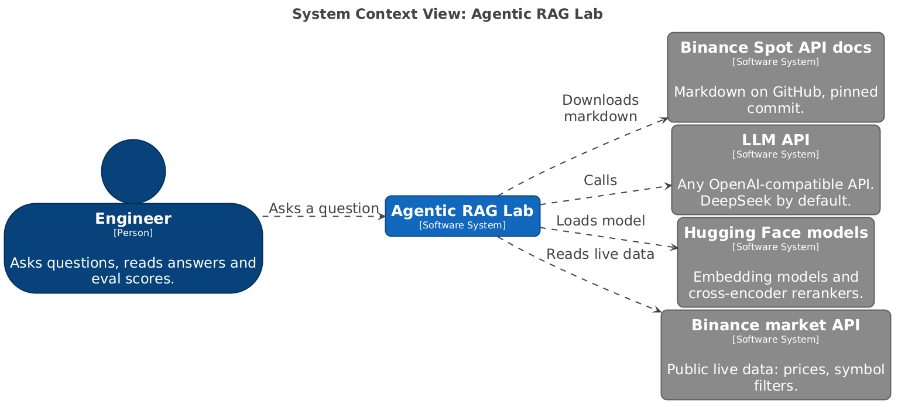
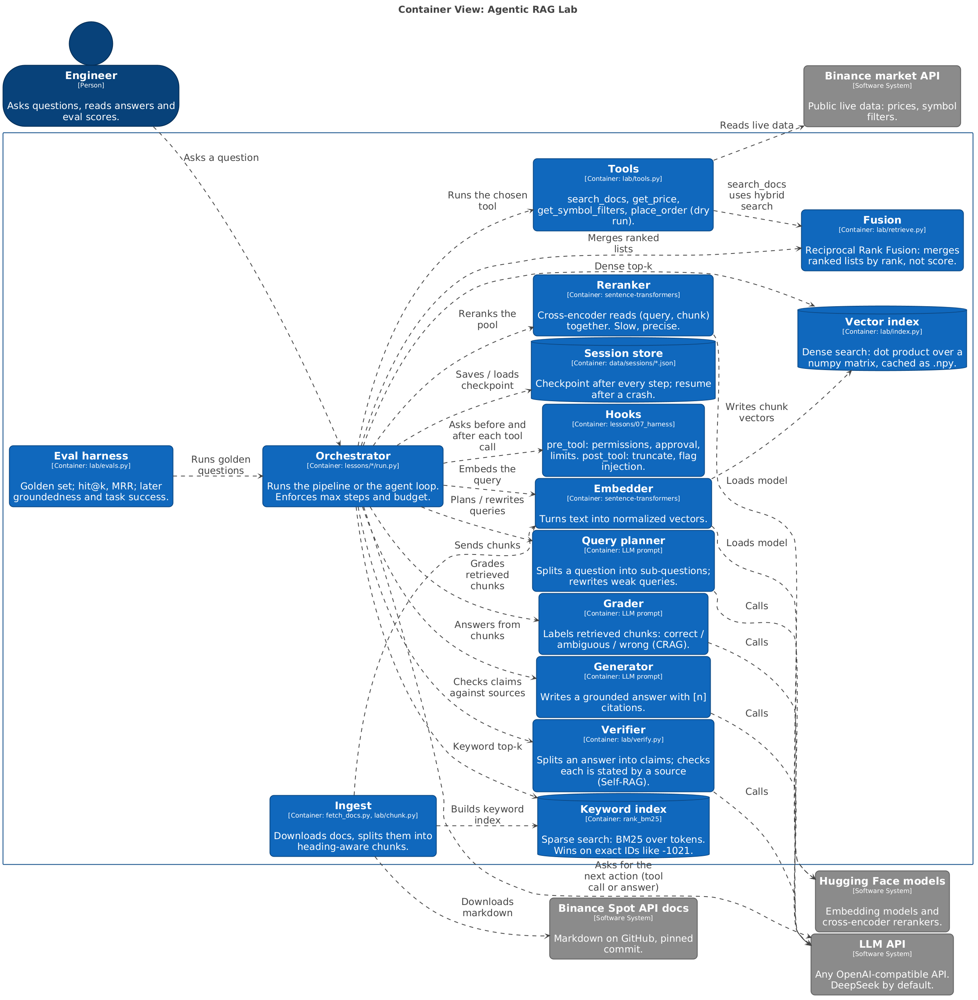
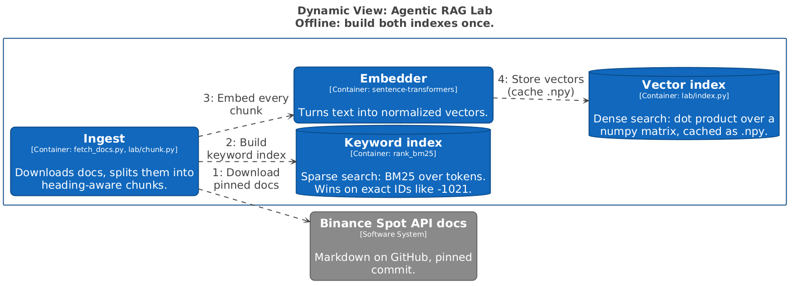
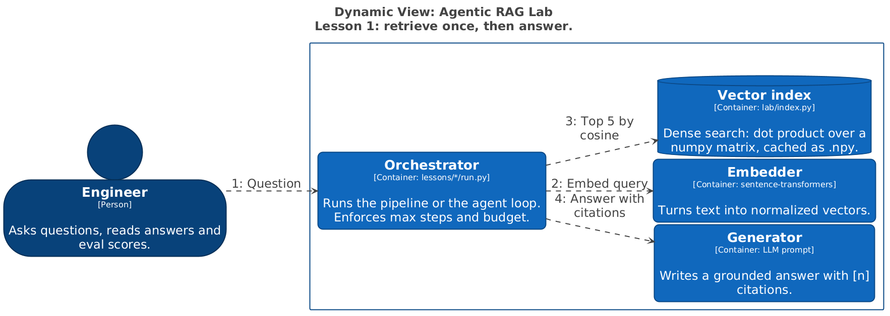
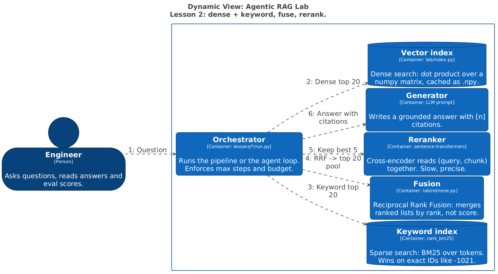
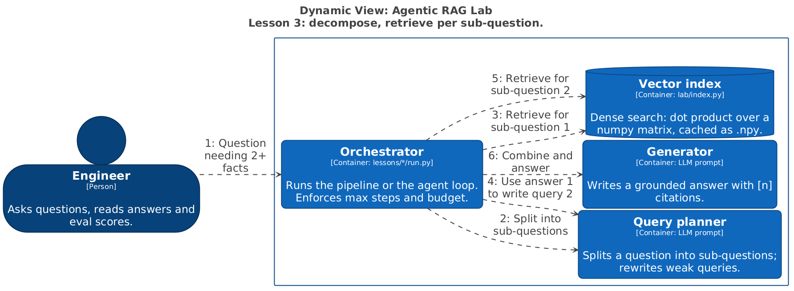
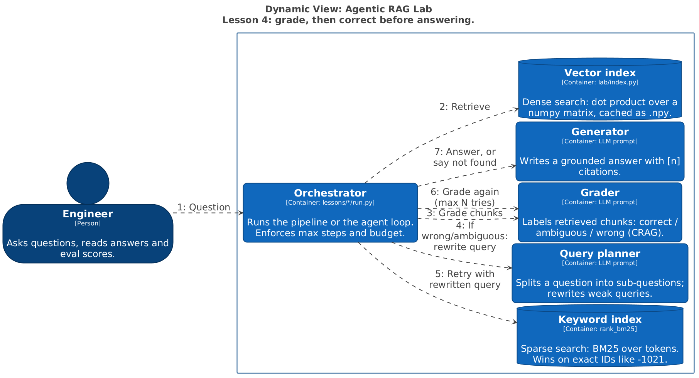
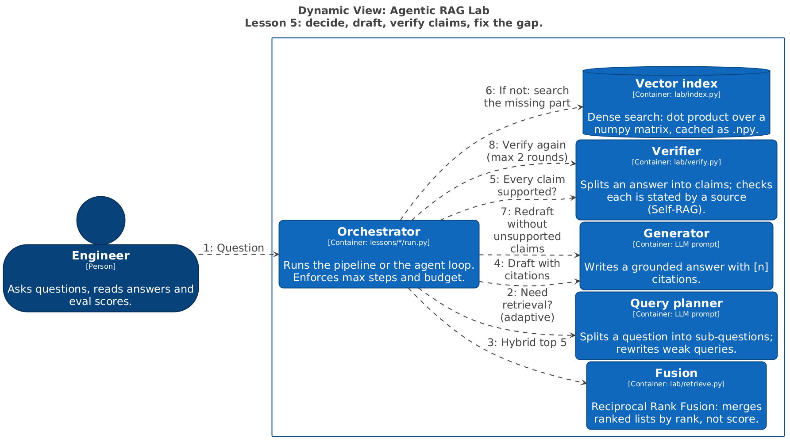
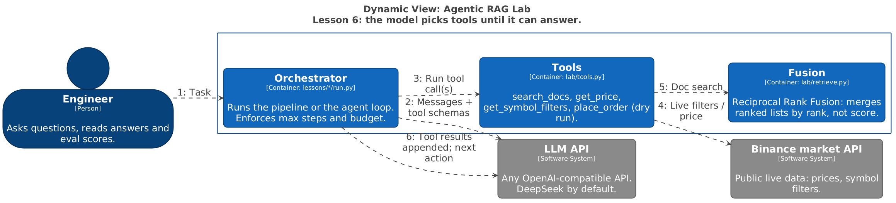
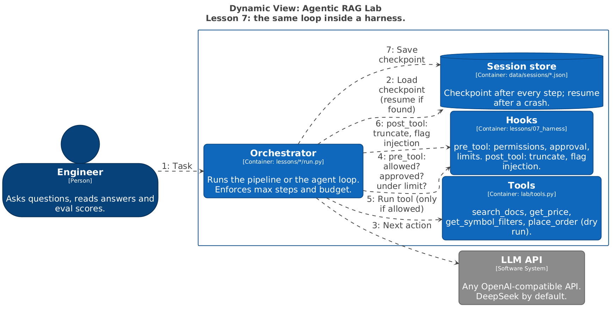

# Diagrams

Generated from `src/workspace.dsl` by `scripts/diagrams.py`. Edit the DSL, not this file.

## Context

## Containers

## Ingest

## L1_Naive

## L2_Hybrid

## L3_MultiHop

## L4_CRAG

## L5_SelfRAG

## L6_AgentLoop

## L7_Harness

